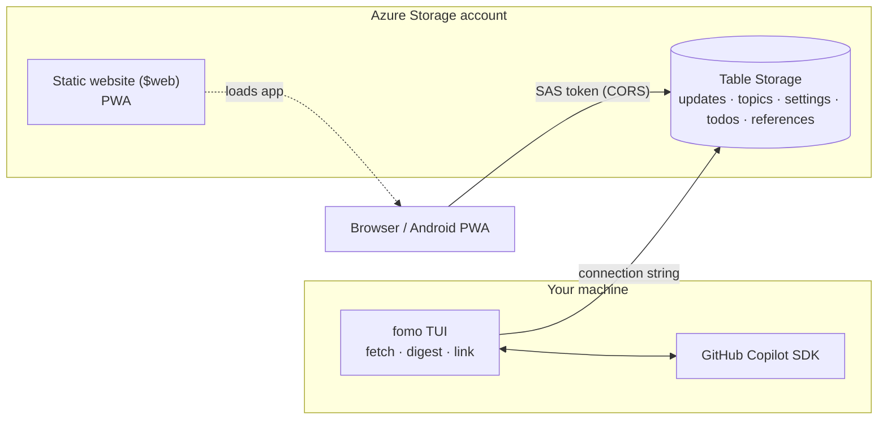

# 📰 FOMO

**Fear Of Missing Out** — a release & update tracker for developer tools.
Track GitHub releases, Azure updates, VS Code changelogs, Copilot CLI versions and tech news in one place,
with a **GitHub Copilot digest** that folds related updates into one topic with a few highlights.

One storage account · No servers · Two interfaces (terminal UI + installable web app)

---

## Table of Contents

- [Architecture](#architecture)
- [Copilot Digest](#copilot-digest)
  - [Post Summaries](#post-summaries)
  - [Bookmarks](#bookmarks)
  - [Todos](#todos)
  - [Colors](#colors)
- [Installation](#installation)
  - [Azure Deployment](#azure-deployment)
  - [TUI Setup](#tui-setup)
  - [Connect the Web App](#connect-the-web-app)
  - [Install on Android](#install-on-android)
  - [Local Development](#local-development)
- [Using the Web App](#using-the-web-app)
- [Using the TUI](#using-the-tui)
  - [Keys](#keys)
  - [Config Screen](#config-screen)
  - [Backup & Restore](#backup--restore)
  - [Profiles (several storage accounts)](#profiles-several-storage-accounts)
- [Sources](#sources)
  - [YouTube](#youtube)
  - [Experimental Sources](#experimental-sources)
- [Security](#security)
- [Environment Variables](#environment-variables)
- [Storage](#storage)
- [License](#license)

---

## Architecture



```
packages/
  core/     Shared types · Azure Table stores · scrapers · digest engine · services
  web/      React/Vite PWA — static files, talks to Table Storage directly
  tui/      Ink terminal UI (`fomo`) — setup, fetch, Copilot digest, device links, backups
```

- **No compute in Azure.** Everything lives in one Storage Account: Table Storage for data and the static website for the web app.
- **Fetch and digest run in the TUI** (`fomo`, then `f`) on your machine, using your GitHub Copilot subscription.
- **The web app is static.** It reads and writes Table Storage from the browser with a SAS token handed over by the TUI's **Link a device** action (magic link / QR code).
- **One storage account per profile.** To keep feeds apart (say work and private), give each its own account and switch with `w`; see [Profiles](#profiles-several-storage-accounts).
- **One command-line option.** `fomo` opens the TUI (`-p <profile>` picks the profile to open); everything else (setup, config, links, backups) is done from inside it.

---

## Copilot Digest

Instead of reading 200 separate updates, the **Unread** view (the default, key `2`) is grouped by topic: one line per product area,
usually 20–30 topics. Press `2` again to switch to a plain list of unread updates, and once more to go back to topics:

```
▸ ▲ Copilot CLI releases                          6   github, github-blog   2h ago
▸ Copilot code review                             9   github                5h ago
▸ Azure networking                                5   azure                 1d ago
▸ Azure retirements                               4   azure                 1d ago
```

Open a topic to see a one-sentence summary and up to six highlights (most important first). Each update in the topic also gets its own one-line summary, so you can decide which ones to open.
A topic with only one update doesn't expand: its row shows that update's title and summary directly, and `Enter` opens the update.
The grouped table's **TIME** column shows each expanded item's reading estimate (`~5m`) or video duration (`15m`), also on single-update topics. Multi-item topic headers leave time blank rather than imply a combined duration.
Mark the whole topic read with `x`, which makes skipping a low-value area a single key press.

The **Pending** view (key `4`) is grouped the same way (press `4` again for a plain list), so pending posts sit together by product area. Reading a pending post
keeps it there: `r` toggles a topic or update read / unread (a blue `●` marks unread ones), `x` marks it read and
moves on, and `p` clears pending on an update, which removes it from the view.

**Experimental grouping.** Each topic is one **product, release stream or specific theme**, such as "Copilot code review", "GitHub Actions", "VS Code releases" or "Azure SRE Agent":

- There is no target group count or size. Single items can stand alone; coherent release streams stay together.
- There are no catch-all topics such as "Azure updates" or "Misc".
- Deprecations and retirements follow the product or theme they affect, not a vendor-wide retirement bucket.
- Releases of one product stay together. Items whose titles differ only in version numbers are flagged to the model as a release series.
- Essays follow their specific theme, not their publisher. Source names and generic terms such as "software" are not grouping criteria.
- A local lexical pass uses [wink-nlp](https://github.com/winkjs/wink-nlp)'s standalone BM25 vectorizer and cosine similarity to compare words and two-word phrases in titles and bodies (up to 12,000 text characters per body), with extra title weight and common words removed. No language model or model download is needed. Its nearest-neighbour clues accompany the original language; Copilot can disagree with them. Similarity scores are lexical overlap, not confidence. Source labels are not included in this calculation. Saved prompts identify the algorithm used; old TF-IDF runs remain inspectable, but their scores are not directly comparable to BM25 scores.
- New products and major launches get their own topic so they aren't buried.

**Importance.** Each topic is rated so you can tell what's worth reading:

| Level  | Shown as                        | Typical updates |
|--------|---------------------------------|-----------------|
| High   | `▲` (orange) · sorted first     | New products, major versions or revamps, big features in widely used tools, flagship models |
| Medium | normal                          | Notable features, previews reaching GA, releases with real changes, breaking changes that hit common setups soon |
| Low    | dimmed · sorted last            | Patches, regions, admin settings, SKUs, distant deprecations, research, partnerships, surveys, marketing |

Deprecations and protocol changes (such as an SSH algorithm) are never rated high. The digest is sorted by importance, then newest first.

To steer the rating toward what you care about, add an optional interests note (`c` → **Interests**), for example
`Copilot CLI and agents, VS Code; not SAP or billing`. It moves a topic up or down by at most one level and never changes the grouping.
Save an empty value to clear it.

To steer the **grouping** itself, add **Grouping hints** (`c` → **Grouping hints**, or `FOMO_GROUPING_HINTS`), for example
`one topic per Copilot surface (CLI, VS Code, code review); keep all Azure AI Foundry news together`.
Hints take priority over the built-in grouping rules, but every update still lands in exactly one topic. They apply to new runs; use **Regroup all topics** to apply them to existing topics.

How it works:

- `f` in the TUI fetches the sources and then runs the digest in the background; new updates show up ungrouped right away and the status bar shows Copilot's progress. Turn **Group after fetch** off in the config screen to fetch only.
- Only **unread or saved updates that don't have a topic yet** are sent to Copilot (pending ones even after you've read them, so the Pending view is grouped too), in two passes:
  1. **Plan:** one call sees every pending update (title and a short excerpt, or its [post summary](#post-summaries) when it has one), lexical similarity clues and the currently open topics. It assigns each update to an existing or new topic, rates it and states a short grouping rationale. Updates the model skips get one more call; items omitted twice get standalone fallback groups.
  2. **Write:** small calls write the summary, highlights and a one-sentence summary of each new update. Large topics are written in batches of 30 items without splitting the visible group; each batch carries the current topic summary forward. Up to 6 topics run concurrently with low reasoning effort, and a failed call is retried once.
- Topics are stored in the `topics` table, and each update points to its topic (`topicId`), so the web app and TUI only read.
- Updates that haven't been digested yet still appear in the grouped Unread and Pending views as single-item entries.
- About 220 updates take roughly 2 minutes. **Max items per run** (default 300) caps a run; the rest are grouped next time.
- The default model is `gpt-5-mini`. Change it with **Copilot model** in the config screen or `FOMO_COPILOT_MODEL`.
- Existing topics keep their grouping and rating. **Regroup all topics** in the config screen (or `z` twice in the TUI's main view) regroups and re-rates all unread and pending updates (read and pending status is untouched). This also fills in per-update summaries for updates digested before they existed.
- Regroup leaves prior assignments in storage until replacements are written. A failed planning call leaves its previous groups intact. If the run is capped, untouched items retain their groups.
- Authentication: pick a GitHub account with **Copilot account** in the config screen. It lists the accounts signed in to the GitHub CLI (`gh auth login`), and FOMO asks `gh` for that account's token. On **Automatic** (the default), it uses `COPILOT_GITHUB_TOKEN` / `GH_TOKEN` / `GITHUB_TOKEN`, else your logged-in Copilot CLI user or gh's active account. If Copilot answers `Authorization error`, the message names the rejected account; choose one with Copilot access.

**Behind the grouping (TUI).** Press `i` in Unread (`2`) or Pending (`4`), in either grouped or list mode, to open the inspector directly without starting a run. `zz` still regroups; a third `z` within five seconds opens the inspector for that run without starting another one. The inspector opens the latest saved run by default. `[` browses older runs; `]` browses newer ones, without regrouping. You can open the inspector before any run to edit guidance or explicitly start one with `r`.

Run evidence is saved locally under `~/.fomo/grouping-runs/<encoded-profile>/` (or beneath `FOMO_CONFIG_DIR`), one JSON file per run, updated atomically as requests progress. Files are private to your OS user and contain article excerpts, prompts, responses, memberships and rationales; they are not uploaded to Azure. Runs remain until you remove their files. A saved request still marked `running` may have been interrupted when the app closed; reopening it does not resume it. History browsing waits for an active job to finish. Read/write failures are shown and audited; grouping can continue with in-memory evidence if saving fails.

- Scroll with arrows (Shift+arrows jumps; Page Up/Down scrolls a page). `i` toggles the supplied system prompts, inputs and raw responses before validation, including item aliases, excerpts and lexical clues. Planning results list memberships and model-stated rationales; these are not internal reasoning. Request states, errors and fallback groups are shown live.
- `f` opens a multiline feedback field. `Ctrl+S` asks Copilot to turn it and the current guidance into a reusable suggestion. Review/edit the suggestion and press `Ctrl+S` again to save it to this profile; `Esc` discards it. `e` edits guidance directly. Guidance is limited to 1,000 characters; remove `FOMO_GROUPING_HINTS` first if it overrides the profile.
- `r` explicitly regroups using the accepted guidance; saving alone does not rerun. Each run freezes its guidance. Feedback and reruns wait until the active job finishes, but the inspector can be read while it runs. `Esc` returns to normal reading. The feedback/refinement loop is available only inside this view; the existing config hints remain an advanced escape hatch.

### Post Summaries

Press `g` on an update in the TUI to have Copilot summarise it: one sentence with the gist, then 3–5 short points (what it does, who it's for, how to get or enable it, limits or deadlines).

- FOMO fetches the linked page and summarises whichever is longer: the page text or the stored preview. The page is only used if it mentions the post's title, so sign-in walls and pages that only render with JavaScript fall back to the preview.
- Azure Updates pages render with JavaScript and the feed cuts their descriptions to about 250 characters, so their full text comes from the Azure release communications API instead (with status and preview / GA dates).
- Posts with less than 1,000 characters of text aren't summarised, because a summary wouldn't be any shorter.
- The summary is saved on the update, so pressing `g` again shows it without calling Copilot. Press `g` once more while it's shown to regenerate it.
- Summaries appear at the top of the detail pane in the TUI and the web app, and search matches them too. The web app only shows saved summaries; it can't create them.
- When Copilot groups a post or writes its topic, it reads the post's summary instead of the start of the feed preview. Summarise posts before they're grouped (or before **Regroup all topics**) to have it take effect.

### Refreshing an Update

Press `u` on an update in the TUI to correct its details from the linked page, e.g. when the reading time is wrong because the feed only had a teaser.

- For YouTube videos it reads the video length again: from the YouTube Data API when a [YouTube API key](#youtube) is set, otherwise from the video page. Fetches don't read video lengths without a key, so press `u` to get one.
- For other posts it works out the reading time from the whole page, and replaces the preview when the page has more text. The page is only used if it mentions the post's title, so a sign-in wall or a JavaScript-only page leaves the update unchanged.
- The status line says what changed. The detail pane shows the reading time or the video length next to the published date.
- The web app can't fetch pages, so it has no `u`. It shows the corrected details after a refresh in the TUI.

### Bookmarks

**Bookmarks** is a link library. It keeps links you want to come back to, filed in a folder tree like `ai/agents` or `azure/iac` (up to 6 levels deep). **Pending** is still for reading later; Bookmarks is for links worth keeping.

- **File a feed update:** press `b` on an update in the TUI or the web app, or use the 🔖 button in the detail pane. The title, URL and any summary are filled in.
  - In the TUI, Copilot also suggests a folder (reusing your existing folders where they fit) and a one-line description. Edit either before saving.
  - If the link is already filed, `b` opens it for editing instead of adding a duplicate.
- **Add any link:** open Bookmarks (`5`) and press `a`. The new link goes in the selected folder.
  - In the TUI form, `^G` asks Copilot to suggest a folder and description, and a title if one is missing. FOMO fetches the page to do this.
- **Folders** exist only as long as they hold links; they're not stored separately. Type a new path to create one.
  - `e` on a folder renames or moves it together with its subfolders (and their colors). `e` on a link edits it.
  - `Enter` or `→` opens a folder, `←` closes it or goes to its parent.
  - `d` twice deletes a link.
- **Colors:** `c` [colors](#colors) the selected link or folder. A link without a color of its own takes its folder's, and a subfolder its parent's.
- **Search** (`/`) matches titles, URLs, folders and descriptions.
- Copilot suggestions run only in the TUI. In the web app, you type the folder and description yourself, picking from existing folders.

### Todos

**Todos** (`6`) are filed in a folder tree like `work/fomo`, exactly like [Bookmarks](#bookmarks): the same folders, keys and colors, in the TUI and the web app.

- **Add** with `a`: subject, due date, folder, notes, attachments and color. Only the subject is required. The new todo goes in the selected folder.
  - The due date takes `2026-03-06`, `today`, `tomorrow`, `mon`…`sun`, `+3` (days) or `2w` (weeks), and the form shows the date it read. The web app also has a date picker.
- **Notes** are optional multiline plain text (the existing Description field). `Enter` adds a line; `Tab` moves to the next field; `Ctrl+S` saves from any field (`Cmd+S` also works on the web). The TUI supports cursor movement with the arrows and scrolls long notes within the form; `e` reads or edits the full notes.
- **Attachments** are optional references, one URL or filesystem path per line. `o` shows them: `↑↓` selects, `Enter` opens the selected URL or local file in the TUI. The web app opens URLs in a new tab and offers **Copy path** for files, because browsers block local-file launching. Files are **not uploaded or synced**; only their paths are stored. Paths must exist on the computer running the TUI; `~` expands to its home directory, relative paths resolve from its working directory, and absolute paths and `file://` URLs are supported. While typing a path in the TUI form, the line under Attachments lists matching files and folders. `Tab` completes the path, or cycles through the matches when several fit. When there's nothing to complete, `Tab` moves to the next field. The web app can't list local folders, so it has no path completion.
- **Status:** `Enter` steps a todo from pending to in progress to done; `x` marks it done or reopens it. Overdue dates show in red, and dates due today or tomorrow in yellow.
- **Folders** exist as long as they hold todos. Each shows a progress bar of how many of its todos are done. `e` on a folder renames or moves it with its subfolders; `e` on a todo edits it.
- `c` [colors](#colors) a todo or folder. `v` shows all, open, in-progress or done todos; `s` sorts by status, due date, newest or subject; `/` searches subjects, notes, folders and attachments; `d` twice deletes a todo.

### Colors

Every color in FOMO is picked from the same popup, in both apps: a source's color (config screen, or its details), and the color of a bookmark, todo or folder (`c`).

- `←↑↓→` move over the palette, `Enter` applies, `Esc` cancels. In the web app you can also click a swatch.
- `#` types any hex color (`#3fb950`).
- `d` resets: a source goes back to its default color; a link, todo or folder goes back to its folder's color.

The popup shows the current color and, when there is none of its own, the color it falls back to.

---

## Installation

### Azure Deployment

**Prerequisites:** Azure CLI (`az login`), `jq`, Node.js 24+ and the pinned pnpm 11.7.0.
The hardened extension backend currently runs only on macOS with MXC Seatbelt available.
Other platforms can still use stored items and declarative feeds, but code extensions fail explicitly.

```bash
pnpm install
bash deploy.sh fomo swedencentral        # add -y to skip the what-if prompt
```

The script:

1. Builds the web app.
2. Deploys `infra/main.bicep`: one Storage Account with the `updates`, `topics`, `settings`, `todos` and `references` tables, plus Table Storage CORS for the static website origin (and `localhost:5173`/`4173` for dev).
3. Enables the static website and uploads the PWA to `$web`.
4. Prints the web app URL and the next steps.

### TUI Setup

```bash
pnpm --filter @fomo/tui... build
node packages/tui/dist/index.js      # or put `fomo` on your PATH: (cd packages/tui && npm link)
```

The first time, `fomo` asks for the storage connection string. Get it with:

```bash
az storage account show-connection-string -g fomo -n <account> -o tsv
```

Paste it and press `Enter`; FOMO checks the connection and saves it to `~/.fomo/config.json`. For a second account (work and private, say), see [Profiles](#profiles-several-storage-accounts).
Then press `c` and set **Web app URL** (printed by `deploy.sh`, e.g. `https://<account>.z1.web.core.windows.net/`).

The digest needs GitHub Copilot. If you use the Copilot CLI, you're already signed in; otherwise export `COPILOT_GITHUB_TOKEN`.
If `gh` has several GitHub accounts, press `c` and pick the one with Copilot under **Copilot account**.
Press `f` to fetch all sources and build the digest.

### Connect the Web App

In the TUI press `c` → **Link a device**. It shows a magic link and a QR code; `o` opens the link, `y` copies it.
Links are valid for 365 days; change **Link valid (days)** in the config screen for shorter-lived links.

Open the link (or scan the QR code with your phone). It carries a Table Storage SAS token in the URL
fragment (`#…`), which is never sent to any server. The web app saves it in the browser and removes it from the address bar.
You can also paste the link into the app's connect screen.

The status bar warns you when the token has 14 days or less left. Create a new link to renew it. **Disconnect** removes the token from that browser.

### Install on Android

1. Open the magic link in **Chrome** on your phone. Scanning the QR code from **Link a device** works well.
2. Tap **⋮ → Add to Home screen → Install**.

FOMO then runs full-screen from your home screen like a native app. The app shell works offline, and data loads from Table Storage when you're online. Pull down on the list to refresh.
On iOS, use Safari → Share → **Add to Home Screen**.

### Local Development

```bash
pnpm install
pnpm build
pnpm test

# Local storage emulator (optional)
npx azurite --silent --location /tmp/azurite &
az storage cors add --services t --origins http://localhost:5173 http://localhost:4173 \
  --methods GET HEAD POST PUT PATCH MERGE DELETE OPTIONS --allowed-headers '*' --exposed-headers '*' \
  --connection-string "UseDevelopmentStorage=true"

# Web app dev server
pnpm --filter @fomo/web dev

# TUI against Azurite: paste UseDevelopmentStorage=true at setup (or set it under c → Connection string;
# w, then a, adds it as a profile of its own, apart from your real accounts),
# set Web app URL to http://localhost:5173/, press f, then c → Link a device to connect the dev server.
fomo
```

With Azurite, **Link a device** creates a SAS token that also allows `http`. The `az storage cors add` command lets the browser call Azurite from the dev server; it mirrors the CORS rule that Bicep sets in Azure.

---

## Using the Web App

The web app mirrors the TUI: the same dark text UI and the same keys. On a phone, tap rows, use the action bar, and pull to refresh.

| Key             | Action                                    |
|-----------------|-------------------------------------------|
| `1` `2` `3` `4` | All / Unread / Read / Pending             |
| `2` / `4` again | Switch Unread / Pending between topics and a list (or click the active tab) |
| `5`             | [Bookmarks](#bookmarks) tab |
| `6`             | [Todos](#todos) tab |
| `Tab` / `Shift+Tab` | Next / previous view (1–6)            |
| `b`             | File the selected update in Bookmarks     |
| `/`             | Search titles & content in the current view (`Enter` searches, `Esc` clears) |
| `v`             | Pick which sources to show (`space` toggle, `a` all, `n` none, `Enter` apply); `Esc` clears it after the search |
| `j` / `↓`       | Next row                                  |
| `k` / `↑`       | Previous row                              |
| `Shift`+`↑` / `↓` | Jump 5 rows (10 on a tall window)       |
| `Enter`         | Topics: expand topic · Lists: toggle detail |
| `→` / `l`, `←`  | Topics: expand / collapse topic           |
| `x`             | Mark read (the whole topic when grouped) & next |
| `r`             | Toggle read / unread (a whole topic when grouped) |
| `n`             | Next topic / next unread                  |
| `p`             | Mark pending / not pending (leaves the Pending view) |
| `d`             | Jump to the duplicate / original of the selected update, if it is in this view |
| `s`             | Cycle the sort order of the view (or click ↕) |
| `o`             | Open URL in a new tab                     |
| `.`             | Toggle preview position (right / bottom)  |
| `c`             | Config (in Bookmarks and Todos: [color](#colors) the selected row) |
| `h`             | Help (also shows the version)             |

Letter keys work in either case: `B` does the same as `b`.

Bookmarks and Todos behave like regular tabs in both apps: pressing `5` or `6` again keeps the current tab open. Switch with `1`–`6` or `Tab` / `Shift+Tab`; `Esc` cancels a prompt or clears a search, not the tab.

Fetching isn't done in the browser. Run `fomo` on your computer and press `f`, then pull to refresh.
Post summaries made in the TUI (`g`) show at the top of the detail pane.

**Search** only looks inside the view you're in: searching under Unread only finds unread updates (or unread topics when grouped), and under Pending only pending updates. Every word must appear in the title, summary, [post summary](#post-summaries) or content (case-insensitive). The query stays applied when you switch views until you clear it with `Esc` or ✕. On a phone, tap the search box in the filter bar.

**Sorting.** `s` cycles through the sort orders of the current view, the same in the web app and the TUI: lists by date, source, title (each ascending / descending) and unread first; topics by importance, date, title and size; Bookmarks by title and date added; Todos by status, due date, created and subject. Each view keeps its own order until you reload or restart.

**Duplicates.** When two sources carry the same post (same title within 60 days), the later copy is kept but flagged `dup`. In both apps, the detail pane lists the rest of the group at the bottom: the original on a copy, the copies on the original. Each entry shows its source, an **other source** tag when it comes from a different feed, and **not in this view** when the current view or filters hide it, so you can always find the counterpart. `d` jumps to the next one that is in the view (press it again to cycle through a group of three or more), expanding its topic when the view is grouped. The web app's **Jump** button in the pane does the same.

---

## Using the TUI

Run `fomo`. It opens on **Unread**, grouped by topic. There are no subcommands. The flags are `-p`/`--profile <name>` (open that [profile](#profiles-several-storage-accounts)), `-v`/`--version` and `-h`/`--help`.

### Keys

| Key             | Action                                    |
|-----------------|-------------------------------------------|
| `1`–`4`         | All / Unread / Read / Pending             |
| `2` / `4` again | Switch Unread / Pending between topics and a list |
| `j`/`↓`, `k`/`↑`| Move                                      |
| `Shift`+`↑` / `↓` | Jump 5 rows (10 on a terminal 40+ lines tall) |
| `Enter`         | Expand topic and open it / toggle detail  |
| `→`/`l`, `←`    | Expand / collapse topic                   |
| `x` / `r`       | Mark topic (or update) read & next (grouped Pending: `r` toggles read in place) |
| `n`             | Next topic / next unread                  |
| `p`             | Mark pending / not pending (leaves the Pending view) |
| `d`             | Jump to the duplicate / original of the selected update, if it is in this view |
| `s`             | Cycle the sort order of the view          |
| `o`             | Open in browser (newest update of a topic)|
| `u`             | [Refresh the update from its page](#refreshing-an-update): reading time, video length, fuller preview |
| `g`             | [Summarise the update with Copilot](#post-summaries) (saved); `g` again while it's shown regenerates it |
| `f`             | Fetch latest updates + Copilot digest     |
| `z` twice       | Regroup all topics with Copilot (`Esc` after the first `z` cancels) |
| `c`             | Config: sources, link a device, backup / restore, local settings |
| `w`             | [Profiles](#profiles-several-storage-accounts): switch, add, rename or remove a storage account (also in Config, Todos and Bookmarks) |
| `5`             | [Bookmarks](#bookmarks): links filed into folders |
| `6`             | [Todos](#todos): tasks filed into folders |
| `Tab` / `Shift+Tab` | Next / previous view (1–6)            |
| `b`             | File the selected update in Bookmarks (Copilot suggests a folder and note) |
| `/`             | Search titles & content in the current view (`Enter` searches, `^U` clears the prompt) |
| `v`             | Pick which sources to show (`space` toggle, `a` all, `n` none, `Enter` apply) |
| `Esc`           | Clear the search, then the source filter  |
| `.`             | Show preview / toggle its position        |
| `a`             | [Audit trail](#audit-trail) of actions and errors (`e` errors only, `Esc` closes) |
| `h`             | Help (also shows the version)             |
| `q`             | Quit                                      |

Letter keys work in either case: `B` does the same as `b`, so `Shift`+`j`/`k` still moves one row. macOS Terminal.app has no default mapping for `Shift`+`↑`/`↓`: add one under Settings → Profiles → Keyboard that sends `\033[1;2A` / `\033[1;2B` (press `Esc` to type `\033`).

The status bar shows counts by status; the config screen shows counts per source.
Search (`/`) works like the web app: it's scoped to the current view, matches every word against the title, summary and content, and shows the query and match count in the filter bar until `Esc` clears it.
The source filter (`v`) lists the sources in the current view with their counts (honouring the search), stays applied across views like the search, and shows as a `src:` chip next to it.
While a fetch, Copilot digest or restore runs, the status bar shows a spinner, the current step and the elapsed time.
While the TUI is open, it automatically fetches every 15 minutes by default, starting one interval after launch. Each run fetches all enabled sources and groups updates with Copilot when auto-digest is enabled, just like `f`. A scheduled run is skipped if a fetch, regroup or restore is already running; closing the TUI stops the timer. The status bar shows when the last fetch finished and when the next automatic one is due (`fetched 19:30 · next 19:45`). Set **Auto-fetch (minutes)** in the config screen to any whole number from 5 to 1440, or to `off` to fetch only with `f`; saving it empty restores 15.
Fetch errors and Copilot runtime logs are written to `~/.fomo/fomo.log` instead of the screen.

#### Audit trail

Every action and every error is recorded in `~/.fomo/audit.log`, one JSON object per line (`ts`, `level`: `info` or `error`, `action`, `detail`, and `profile` once there is more than one [profile](#profiles-several-storage-accounts)). This covers:

- **Runs:** manual and automatic fetches (including skipped runs and each failed source), Copilot digests and regroups (each failed Copilot call), summaries, backups and restores.
- **Reading:** read / unread / save changes (with the update title), opening links, views, searches and source filters.
- **Settings, todos and references:** todos, references, source and config changes, profile switches, additions, renames and removals, linking a device and setup.
- **Errors:** storage errors, `console.error` output and crashes.

Press `a` to browse it, newest first. Use `↑`/`↓` to move (the full message of the selected entry shows below the list), `e` to show errors only and `Esc` to close. The view updates while it's open.

With several profiles, the list tags each entry with the profile it happened in (`[work]`).

Connection-string keys and SAS signatures are masked, and the device link itself is never recorded. When the file reaches 1 MB it moves to `audit.log.1`, so at most about 2 MB is kept.

### Config Screen

Press `c`. The bottom line shows the keys for the selected row. Each section header folds: `Enter`/`←` collapses it, `Enter`/`→` expands it, and `←` on any row folds its section. The list scrolls with the focus; `Shift+↑/↓` jumps 5 rows (10 on a tall screen) and `PgUp`/`PgDn` move a page. `/` filters the rows (all words must match; a matching section name keeps its whole section), `Enter` keeps the filter and `Esc` clears it. The help overlay (`h`) has the same `/` search.

| Section | Row | Keys |
|---------|-----|------|
| **Actions** | Link a device | `Enter`: magic link + QR code for the web app (`o` open, `y` copy) |
| | Switch profile | `Enter`: open the [profile](#profiles-several-storage-accounts) list (same as `w`) |
| | Show web app QR | `Enter`: QR code of the plain web app URL (no access token) to open it on your phone · `o` opens it in the browser |
| | Regroup all topics | `Enter` twice: rerun the Copilot digest on every unread and pending update |
| | Back up updates / Restore from backup | See [Backup & Restore](#backup--restore) |
| **Sources** (shared with the web app) | One row per source, with its item count, when its newest item was added, and when it was last fetched (or the error of that fetch) | `Enter` details (status, label, color, on/off; name, URLs and filter for your own sources; `s` saves) · `Space` enable/disable · `e` label · `d` [color](#colors) · `f` fetch just this source (even if disabled) · `v` list only its updates · `x` remove (`x` again keeps its items, `d` deletes them too). A removed source whose items are kept stays greyed out until you delete them (`x` twice, or `d` twice in its details); in a source's details `d` twice deletes its items, so the next fetch brings them back as new. **+ Add source** adds a feed, GitHub repo or YouTube channel; **Restore removed** brings back removed built-ins |
| **Display** (shared) | Preview position | `Enter` cycles right / bottom / off |
| **Experimental sources · this computer** | One row per [experimental source](#experimental-sources), off by default, per profile | `Enter` details (label, color, name, extension name, on/off; `s` saves) · `Space` twice: sign in and turn it on (then it is fetched; the row shows `sign-in…` until the sign-in finishes) · `Space` turns it off (its items stay) · while it signs in or fetches, `Space` twice cancels the sign-in or stops the fetch and turns it off · `e` label · `d` color · `l` sign in again · `f` fetch it · `v` list its updates · `x` twice deletes its items |
| **This computer** (`~/.fomo/config.json`) | Connection string, Web app URL, Copilot model, Copilot account, Interests, Grouping hints, YouTube API key, Auto-fetch (minutes), Group after fetch, Max items per run, Link valid (days), Backup folder | `Enter` edits (Auto-fetch takes 5–1440 minutes or `off`; Group after fetch toggles; Copilot account opens a list of your `gh` accounts). Save an empty value to restore the default. The connection string and YouTube API key are masked, also while you type them and in the audit trail. Values set by an environment variable are tagged `[env]`. `o` on Web app URL opens it in the browser. With several [profiles](#profiles-several-storage-accounts) the section title names the one being edited; every setting here belongs to it. |

### Backup & Restore

**Back up updates** writes every update from Table Storage to `fomo-backup-<timestamp>.json` in the backup folder
(default `~/.fomo/backups`, or `~/.fomo/backups/<profile>` for every [profile](#profiles-several-storage-accounts) except `default`; change it under **Backup folder**).

**Restore from backup** lists the `.json` files in the backup folder, newest first. Pick one and press `Enter` twice.
Entities are upserted, so this is safe for both fresh and incremental restores; nothing is deleted.

The backup format is `{ version: 1, exportedAt, count, entities: [...] }`.

### Profiles (several storage accounts)

A profile is one storage account plus the local settings that go with it (Copilot account, interests, backup folder, …). Keep feeds apart by giving each its own account, for example **work** and **private**: each has its own updates, topics, todos and bookmarks, and nothing from one shows up in the other. First-run setup creates the `default` profile.

Press `w` (in the main list, Config, Todos or Bookmarks, or **Config → Switch profile**) to open the list. With two or more profiles the status bar shows `[w] <name>`, and the config screen and audit trail name the profile too.

| Key | Action |
|-----|--------|
| `↑`/`↓`, `j`/`k` | Move (`Shift`+`↑`/`↓` jumps 5 rows, 10 on a tall screen) |
| `Enter` | Switch to the profile; FOMO opens it again next time |
| `a` | Add: type a name, then paste its connection string. FOMO checks it, saves the profile and switches to it. When the check fails (storage unreachable, say), `Enter` again saves it anyway |
| `e` | Rename (the profile keeps its settings and backups) |
| `x` | Remove (`x`, `y` or `Enter` confirms; any other key cancels) |
| `Esc` / `w` | Close |

- **Start on a profile:** `fomo -p work`, or `FOMO_PROFILE=work fomo`. This applies to that run only; the profile you switch to inside the app is the one `fomo` opens when you give none.
- **Names:** 1–32 letters, digits, `.`, `_` or `-`, starting with a letter or digit; unique ignoring case (a profile's name is also its backup folder).
- **Switching or adding** while a fetch, digest or restore is running is refused until it finishes. A profile without a connection string can't be switched to.
- **Removing** only forgets the profile in `config.json`. The storage account, its data and its backup files are not touched. You can't remove the profile in use or the last one.
- **Web app:** one account per install. Each storage account has its own web app URL, so set **Web app URL** in every profile, use **Link a device** in the profile you want on that device, and install one PWA per account.
- **Config file:** `~/.fomo/config.json` becomes `{ "activeProfile": …, "profiles": { … } }` the first time you save in a version with profiles; an existing file becomes the `default` profile. An older `fomo` doesn't know this format and would overwrite it, so keep a copy before going back to one.
- **Environment variables:** `FOMO_WEB_URL`, `FOMO_COPILOT_MODEL`, `FOMO_INTERESTS`, `FOMO_GROUPING_HINTS` and `FOMO_YOUTUBE_API_KEY` override every profile. `AZURE_STORAGE_CONNECTION_STRING` is only a fallback for a profile whose config has no connection string.

---

## Sources

### Built-in Sources

| Source | ID | What it tracks |
|--------|----|----------------|
| GitHub | `github` | GitHub Releases (Node.js, TypeScript, etc.) |
| GitHub Blog | `github-blog` | GitHub Blog posts |
| Azure | `azure` | Azure Updates RSS feed |
| VS Code | `vscode` | VS Code releases (official Atom feed) |
| Copilot CLI | `copilot-cli` | GitHub Copilot CLI releases |
| The Register | `theregister` | The Register tech news (Atom feed) |
| Anthropic News | `anthropic-news` | Anthropic news |
| Anthropic Engineering | `anthropic-engineering` | Anthropic engineering blog |
| Azure SRE Agent | `azure-sre-agent` | Azure Updates announcements and Apps on Azure Tech Community posts mentioning SRE Agent |
| GitHub Next | `github-next` | GitHub Next research & prototypes (RSS) |

The Azure SRE Agent source combines Microsoft's public Azure Updates RSS feed
with the latest 100 posts from Tech Community's Apps on Azure blog, filtering
titles and descriptions for SRE Agent mentions. This includes blog guides and
feature posts as well as release announcements, without the legacy Azure Charts
endpoint's authentication requirement. These are rolling feeds (Azure Updates
currently returns 200 announcements), not complete archives or date-based resume
APIs. Each fetch adds previously unseen URLs; stored updates are retained.

### Adding a New Source

Most sources need no code:

- **From the app:** in the TUI press `c` → **+ Add source** and type an RSS/Atom feed URL (several: separate with
  spaces), `https://github.com/owner/repo` or a YouTube channel/playlist URL, a name, and an optional keyword filter (regex). In the web app use
  the form under ⚙️ Config → **Sources**. Sources you add are stored in the shared settings; `x` (TUI) or ✕ (web)
  removes a source, and removed built-ins can be restored. Open a source (`↵` in the TUI, click its name in the
  web app) to see its status and edit it.
- **Built-in:** add a `feed`, `github-releases` or `youtube` spec to `BUILTIN_SOURCES` in
  `packages/core/src/scraper/specs.ts`.
- **Custom code** (sites without a feed): bundled ESM extensions live in `packages/extensions/`, outside the
  fetch engine. A `custom` spec references their stable extension ID; the TUI runs them in an MXC sandbox.
  Third-party installation and permission/reapproval UI are not available yet.

See [EXTENDING.md](EXTENDING.md) for the API, build layout and current isolation limits.
Source display names and extension names can be edited independently; IDs never change. Config shows the
extension as `C/<name>`. Short labels are limited to 10 characters and retain their configured color.

### YouTube

Only the TUI fetches YouTube sources. How depends on whether the profile has a **YouTube API key**:

- **With a key** (recommended), FOMO uses the official [YouTube Data API v3](https://developers.google.com/youtube/v3): the 15 newest videos and live streams of a channel (and Shorts when the source has them turned on) or playlist, with their full description and length. Each fetch costs 2 quota units per channel (3 when it has new videos, 1 more with Shorts), so a dozen channels fetched every 15 minutes all day use about 2,500 of the free 10,000 units a day. Live streams get their length once they end.
- **Without a key**, FOMO reads YouTube's public feeds (also the 15 newest videos), which have no video lengths. It doesn't open each video's page while fetching, since YouTube throttles that; press `u` on a video to read its length.
- When the daily quota is used up, fetches fall back to the public feeds until it resets (midnight Pacific time). A wrong or restricted key shows up as the source's fetch error under **Config → Sources**.

**Create a YouTube API key** (free; no billing needed):

1. Open the [Google Cloud console](https://console.cloud.google.com/) and create a project (or pick one).
2. Under **APIs & Services → Library**, find **YouTube Data API v3** and click **Enable**.
3. Under **APIs & Services → Credentials**, click **Create credentials → API key**.
4. Edit the key: under **API restrictions** pick **Restrict key** and select only **YouTube Data API v3**. Leave **Application restrictions** at *None*, because the TUI runs on your computer and not in a browser.
5. In the TUI press `c` → **YouTube API key**, paste it and press `Enter` (or set `FOMO_YOUTUBE_API_KEY`).

The key is a local setting of the profile: it stays in `~/.fomo/config.json` (or the environment) and is never written to Azure, backups or the audit trail. FOMO sends it in the `X-Goog-Api-Key` header, never in a URL.

### Experimental Sources

Experimental sources read your own data with a sign-in on this computer, so only the TUI fetches them, and only in
the profiles where you turned them on (**Config → Experimental sources**). Their items show up in the web app like any other update.

| Source | ID | What it tracks |
|--------|----|----------------|
| Teams meetings | `teams-meetings` | Teams meetings of the last 7 days that you missed, or that have a recording or a transcript; one item per occurrence, linking directly to the meeting recap when recorded or transcribed, otherwise to the meeting chat |

**Teams meetings** runs its fetch, classification and merge code in a bundled extension. The pinned WorkIQ
process runs **outside FOMO's sandbox**, using the host WorkIQ sign-in and host filesystem/network permissions.
The TUI labels it **UNSANDBOXED** and asks for explicit consent before enabling it. FOMO's MCP broker only allows
the configured read-only Graph operations for recent meetings, chats and transcripts, plus read-only
OneDrive/SharePoint search used to locate recording files; the extension never receives WorkIQ tokens.
Profile-specific approval is stored under
`~/.fomo/extension-state/<profile-name-hash>/workiq`; renaming a profile requires approval again. Disabling the
source or changing profiles revokes its active fetches.

Recap links are built like the
links Teams shares: the meeting chat, the occurrence ID and the recording file, which FOMO takes from the meeting chat
or, when the chat is closed to you, finds with a file search (this takes a few seconds per meeting on the first
fetch). Without the file, a recurring meeting's link also has the series ID, so it opens that day's recap with a list
of the other days. A few meetings only open with the file; if it can't be found, their link shows "You don't have
permissions to view recap".
If the occurrence ID is missing, the item links to the meeting chat instead; the chat link is also kept in every item's
preview. The next fetch refreshes links for meetings in the 7-day window and adds recordings or transcripts that
appeared later, without creating duplicate items or changing their read/saved status.

---

## Security

- **Code-backed sources:** Anthropic (news and engineering), Copilot CLI and Teams run in checksum-verified,
  read-only snapshots under deny-by-default MXC policies. Workers cannot fork processes, access host credentials
  or connect directly to the network. Public HTTPS requests go through a bounded, origin-allowlisted broker
  that validates and pins DNS addresses and rechecks redirects. WorkIQ alone has separate HTTPS access and its
  own private profile directory; it is not an unrestricted host MCP connection.
- **Current limits:** only bundled extensions are accepted. CPU/wall time, messages and response sizes are bounded;
  the worker's 128 MiB V8 heap setting is **not** a hard total-memory cap. Arbitrary extension installs, approved
  user-folder grants, other OS backends and sandboxing the whole FOMO process remain future work.
  RSS/Atom, GitHub-release and YouTube fetchers still use their existing trusted implementation.
- **TUI:** uses the storage connection string (account key). Keep `~/.fomo/config.json` private (it is created with mode `600`); with several [profiles](#profiles-several-storage-accounts) it holds the key of each account, and the [YouTube API key](#youtube) if you set one. Restrict that key to the YouTube Data API v3 only.
- **Web app:** uses an **account SAS token** limited to the Table service and entity operations (`ss=t`, `srt=o`, `sp=raud`), HTTPS only, and valid for **Link valid (days)** (default 365).
  - It can read and update your FOMO tables, but it cannot create or delete tables or touch blobs.
  - It is delivered in the URL fragment, so it never reaches a web server or logs, and it is stored in the browser's `localStorage`.
- **Revoke every link:** rotate the storage key that signed it (**Link a device** signs with the key in your connection string, usually `key1`):
  ```bash
  az storage account keys renew -g fomo -n <account> --key key1
  ```
  Then set the new connection string in the TUI (switch to that account's profile, then `c` → **Connection string**) and link your devices again.
- **CORS:** Table Storage only accepts browser calls from the static website origin (and localhost dev ports). Add custom domains with the `extraCorsOrigins` Bicep parameter.
- The static website itself is public, but it contains no data.

---

## Environment Variables

All are optional. The TUI config screen (`c` → **This computer**) stores the same values in `~/.fomo/config.json`, per [profile](#profiles-several-storage-accounts).

| Variable                          | Description                                                  |
|-----------------------------------|--------------------------------------------------------------|
| `AZURE_STORAGE_CONNECTION_STRING` | Connection string (fallback for a profile whose config has none) |
| `FOMO_PROFILE`                    | Profile to open when `-p`/`--profile` isn't given (default: the one used last) |
| `FOMO_CONFIG_DIR`                 | Folder for the config file, logs, audit trail and backups (default `~/.fomo`) |
| `FOMO_WEB_URL`                    | Web app URL for **Link a device** (overrides config, every profile) |
| `FOMO_COPILOT_MODEL`              | Copilot model for the digest (overrides config, every profile) |
| `FOMO_INTERESTS`                  | Interests note for digest importance (overrides config, every profile) |
| `FOMO_GROUPING_HINTS`             | Grouping hints for the digest (overrides config, every profile) |
| `FOMO_YOUTUBE_API_KEY`            | [YouTube Data API key](#youtube) for YouTube sources (overrides config, every profile) |
| `COPILOT_GITHUB_TOKEN` / `GH_TOKEN` / `GITHUB_TOKEN` | Token for the Copilot SDK when **Copilot account** is Automatic (default: logged-in Copilot CLI user or gh's active account) |

---

---

## Storage

| Table      | PartitionKey                       | RowKey                       | Contents                              |
|------------|------------------------------------|------------------------------|---------------------------------------|
| `updates`  | Source ID (e.g. `azure`, `github`) | `sha256(url).slice(0, 32)` (an experimental source's item: `sha256(key)`, e.g. one per meeting occurrence) | Updates, status, saved, `topicId`, Copilot `summary` and `gist` (post summary, JSON) |
| `topics`   | `topic`                            | Topic id                     | Copilot title, summary, highlights    |
| `settings` | —                                  | —                            | Shared UI/source settings             |
| `todos`    | `todo` (`folder` for the colors row) | UUID (`colors`)            | Todos: subject, multiline notes (`description`), URL/path attachments (JSON), due date, status, folder path (`work/fomo`), color; one `colors` row holds the folder colors (JSON) |
| `references` | `ref` (`folder` for the colors row) | UUID (`colors`)           | Bookmarked links: title, URL, folder path (`ai/agents`), description, color, source `updateId`; one `colors` row holds the folder colors (JSON) |

Status updates use ETag-based optimistic concurrency.

---

## License

MIT
