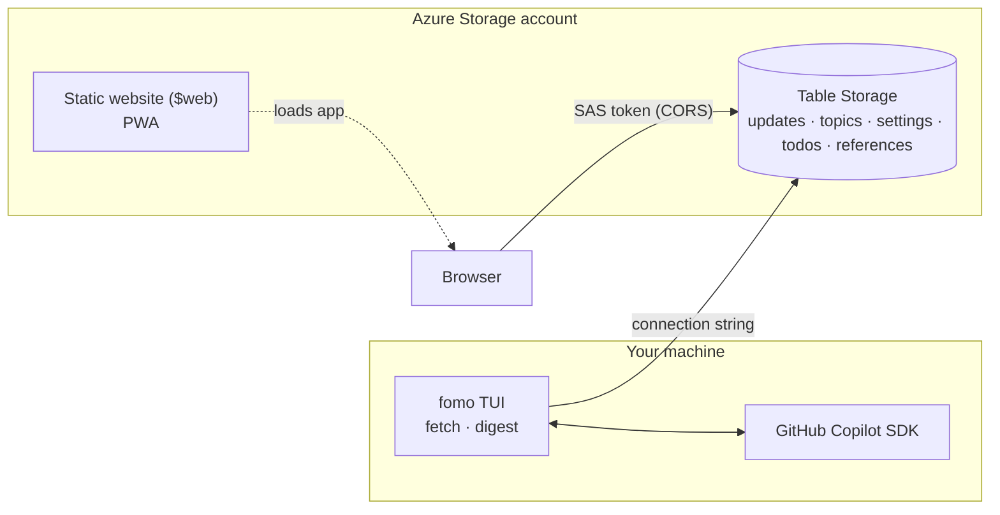

# 📰 FOMO

**Fear Of Missing Out** — one personal inbox for updates, so you don't have to check each source separately.
FOMO starts with releases of FOMO itself; add the feeds and GitHub releases you care about, then use a
**GitHub Copilot digest** to group related updates and surface what may be worth your attention.

Fetches and digests run on your computer. Your data lives in Azure Storage that you control, and you can read
it from the terminal app or a connected browser.

---

## Table of Contents

- [How FOMO works](#how-fomo-works)
- [Profiles](#profiles)
- [Copilot Digest](#copilot-digest)
  - [Post Summaries](#post-summaries)
  - [Bookmarks](#bookmarks)
  - [Todos](#todos)
- [Installation](#installation)
  - [Azure Deployment](#azure-deployment)
  - [TUI Setup](#tui-setup)
  - [Connect the Web App](#connect-the-web-app)
  - [Local Development](#local-development)
- [Using the Web App](#using-the-web-app)
- [Using the TUI](#using-the-tui)
  - [Backup and Restore](#backup-and-restore)
- [Sources](#sources)
  - [Adding a New Source](#adding-a-new-source)
  - [YouTube](#youtube)
  - [Experimental Sources](#experimental-sources)
- [Security](#security)
- [Environment Variables](#environment-variables)
- [License](#license)

---

## How FOMO works



```
packages/
  core/     Shared types · Azure Table stores · scrapers · digest engine · services
  web/      React/Vite PWA — static files, talks to Table Storage directly
  tui/      Ink terminal UI (`fomo`) — setup, fetch, Copilot digest, device links, backups
```

- **FOMO is local-first.** The TUI fetches sources and runs the digest on your computer; Azure hosts the data and static web app, not a FOMO service.
- **Copilot turns a feed into a reading queue.** Related updates are grouped into topics, with summaries and an importance rating. You can steer grouping and importance to match your interests.
- **The browser is a companion reader.** It reads and updates the same stored items as the TUI, but it does not fetch sources or call Copilot.
- **Profiles keep accounts separate.** Each profile points to its own storage account and local preferences, so work and personal feeds stay distinct.

## Profiles

A profile connects one Azure Storage account with its local FOMO settings. Use separate profiles for contexts such as **work** and **personal**: updates, topics, todos and bookmarks stay in the account for that profile, while settings such as Copilot account, interests, YouTube key and backup location travel with it. Each profile has its own connection string and local credentials; the TUI remembers the last active profile.

Add an account by creating a profile with its storage connection string. Switching profiles changes which account the TUI reads and writes; it does not copy or merge data. An operation already fetching, digesting or restoring must finish before switching.

The browser app connects to one account at a time. Link it from the profile you want to read, and use a separate browser profile or installation for another account. Removing a FOMO profile only removes its local configuration; it does not delete the Azure account, its data or backups. `fomo -p work` or `FOMO_PROFILE=work` can select a profile when starting the TUI. Environment variables can override selected settings across profiles; see [Environment Variables](#environment-variables).

---

## Copilot Digest

Unread and pending updates are grouped by product or subject instead of appearing only as a long chronological feed. A topic gives a short explanation and highlights, with individual update summaries to help decide what to open. Topics can be reviewed together or as individual updates; updates without a digest remain visible on their own.

Read and pending status are independent. Reading an item does not remove it from the pending queue, and marking a topic read does not change whether its items were saved for later.

**Grouping.** Each topic represents a **product, release stream or specific theme**, such as "Copilot code review", "GitHub Actions", "VS Code releases" or "Azure SRE Agent":

- Related releases stay together, while unrelated announcements are not forced into broad catch-all topics.
- Deprecations and essays are grouped by the product or subject they affect, not merely by publisher.
- New products and major launches can get their own topic so they are not buried.

**Importance.** Each topic is rated so you can tell what's worth reading:

| Level  | Typical updates |
|--------|-----------------|
| High   | New products, major versions or revamps, widely useful features, flagship models |
| Medium | Notable features, releases with meaningful changes, and breaking changes affecting common setups |
| Low    | Patches, regional or administrative changes, distant deprecations, research and marketing |

The digest prioritizes higher-importance topics, then newer ones. Deprecations and protocol changes are not rated high by default.

An optional interests note can nudge a topic's importance by one level without changing its grouping.

Grouping hints steer topic boundaries and take priority over the default grouping rules. They apply to new runs; regrouping can apply them to existing unread and pending updates. Each update is assigned to one topic.

Fetching a source adds new items to the account. The TUI can group new unread and saved items after a fetch, or fetch without grouping; items awaiting a digest remain visible on their own. Existing topics are left in place unless you choose to regroup. A regroup updates topic assignments and ratings without changing read or pending status.

The digest uses the Copilot account selected in the TUI settings. Interests can nudge importance, while grouping hints can steer topic boundaries; both are local settings for the profile. The default model and item limit can be changed in settings or with the corresponding environment variables.

The TUI includes an inspector for reviewing a digest run and refining grouping guidance. Run evidence is saved locally and is not uploaded to Azure; it can include excerpts and model responses, so treat it as private data.

### Post Summaries

The TUI can ask Copilot to summarise an update: one sentence with the gist, followed by a few points about what it does, who it's for, how to get or enable it, and any limits or deadlines.

- FOMO fetches the linked page and summarises whichever is longer: the page text or the stored preview. The page is only used if it mentions the post's title, so sign-in walls and pages that only render with JavaScript fall back to the preview.
- Azure Updates pages render with JavaScript and the feed cuts their descriptions to about 250 characters, so their full text comes from the Azure release communications API instead (with status and preview / GA dates).
- Posts with less than 1,000 characters of text aren't summarised, because a summary wouldn't be any shorter.
- The summary is saved on the update, so it can be read again without another Copilot request. It can also be regenerated.
- Summaries appear at the top of the detail pane in the TUI and the web app, and search matches them too. The web app only shows saved summaries; it can't create them.
- When Copilot groups a post or writes its topic, it uses the post summary in preference to the start of the feed preview.

### Refreshing an Update

The TUI can refresh an update's details from its linked page, for example when the feed only provided a teaser.

- For YouTube videos it reads the video length again: from the YouTube Data API when a [YouTube API key](#youtube) is set, otherwise from the video page. Regular fetches only get video lengths when an API key is set.
- For other posts it works out the reading time from the whole page, and replaces the preview when the page has more text. The page is only used if it mentions the post's title, so a sign-in wall or a JavaScript-only page leaves the update unchanged.
- The detail pane shows the corrected reading time or video length next to the published date.
- The web app can't fetch pages; it shows corrected details after a refresh in the TUI.

### Bookmarks

**Bookmarks** is a link library for pages worth keeping, separate from the Pending queue for things to read later. Links can be filed in nested folders, and a feed update can be saved with its title, URL and summary.

- Links can be added directly or saved from an update. The TUI can suggest a folder and description; in the web app, these are entered by hand.
- Folders come from their contents or saved metadata. Bookmarks and Todos use the same folder editor for name/location, color, local directory and GitHub repository, without a type. Renaming or moving a folder also moves its contents and metadata; each view keeps its folders separate. Deleting a folder (`d`) asks first: move its contents (items and subfolders) up into the parent folder, or delete everything in it. Either way the folder's own color and metadata go with it.
- In both views, Enter edits the selected item or folder; Left/Right navigate folders. In Bookmarks, `o` opens a link.
- Bookmarks are stored with the profile's Azure account and can be browsed in either app.

### Todos

Todos and ideas share one nested folder tree. Todos can have a due date; ideas cannot. Both can have notes and URL or local file-path references, and the list can show both types or filter to either one. Converting an idea to a todo keeps its identity and folder. Idea workflow stages are intentionally not fixed yet.

Todos move through pending, in-progress and done states. Folder progress counts todos, not ideas. Folders have no todo/idea type and can hold both. Their edit form combines name/location, color, an optional local-directory path and GitHub repository association; the latter two are metadata only and do not grant access or trigger repository or filesystem operations. Clearing a folder's color restores its inherited parent color or the default. In both folder trees, the TUI can explicitly open associated paths and repositories. It can also open URL and local-path attachments; the web app can open URLs and copy paths, but local files are not uploaded or synced.

---

## Installation

### Azure Deployment

**Prerequisites:** Azure CLI (`az login`), `jq`, Node.js 24+ and the pinned pnpm 11.7.0.
The hardened extension backend currently runs only on macOS with MXC Seatbelt available.
Other platforms can still use stored items and declarative feeds, but code extensions fail explicitly.

```bash
pnpm install
bash deploy.sh fomo swedencentral        # add -y to skip the what-if prompt
```

The script:

1. Builds the web app.
2. Deploys `infra/main.bicep`: one Storage Account with the `updates`, `topics`, `settings`, `todos` and `references` tables, plus Table Storage CORS for the static website origin (and `localhost:5173`/`4173` for dev).
3. Enables the static website and uploads the PWA to `$web`.
4. Prints the web app URL and the next steps.

### TUI Setup

```bash
pnpm --filter @fomo/tui... build
node packages/tui/dist/index.js      # or put `fomo` on your PATH: (cd packages/tui && npm link)
```

The first time, `fomo` asks for the storage connection string. Get it with:

```bash
az storage account show-connection-string -g fomo -n <account> -o tsv
```

Paste the connection string into FOMO's setup; it checks the connection and saves it locally. For additional accounts, create separate [profiles](#profiles).
Set the **Web app URL** in the profile settings (printed by `deploy.sh`, e.g. `https://<account>.z1.web.core.windows.net/`).

The digest needs GitHub Copilot. If you use the Copilot CLI, you're already signed in; otherwise export `COPILOT_GITHUB_TOKEN`.
If `gh` has several GitHub accounts, select the account with Copilot access in profile settings. Start a fetch from the TUI to collect updates and build the digest.

### Connect the Web App

Use **Link a device** in the TUI settings to create a magic link or QR code.
Links are valid for 365 days by default; change **Link valid (days)** in settings for shorter-lived links.

Open the link in a browser (or scan the QR code). It carries a Table Storage SAS token in the URL
fragment (`#…`), which is never sent to any server. The web app saves it in the browser and removes it from the address bar.
You can also paste the link into the app's connect screen.

The status bar warns you when the token has 14 days or less left. Create a new link to renew it. **Disconnect** removes the token from that browser.

### Local Development

`pnpm install` uses the registry configured in your local pnpm environment; this repository does not select one.

```bash
pnpm install
pnpm build
pnpm test

# Local storage emulator (optional)
npx azurite --silent --location /tmp/azurite &
az storage cors add --services t --origins http://localhost:5173 http://localhost:4173 \
  --methods GET HEAD POST PUT PATCH MERGE DELETE OPTIONS --allowed-headers '*' --exposed-headers '*' \
  --connection-string "UseDevelopmentStorage=true"

# Web app dev server
pnpm --filter @fomo/web dev

# TUI against Azurite: create a separate profile with UseDevelopmentStorage=true,
# set Web app URL to http://localhost:5173/, fetch data, then use Link a device to connect the dev server.
fomo
```

With Azurite, **Link a device** creates a SAS token that also allows `http`. The `az storage cors add` command lets the browser call Azurite from the dev server; it mirrors the CORS rule that Bicep sets in Azure.

---

## Using the Web App

The web app is a companion for reading and organizing the data in a profile's storage account. It shows the updates, digest topics, bookmarks and todos available in that account, and changes such as read status are shared with the TUI.

It does not fetch sources or generate summaries and topics; those tasks run in the TUI. After a fetch or digest, refresh the browser app to see the latest stored data. Search and filters apply to the current view, and duplicate updates are linked so you can find related copies across sources.

The app can be used in a desktop or mobile browser. Browser installation is optional; the connected web app works as a regular web page.

---

## Using the TUI

Run `fomo` to open the TUI. It starts with unread updates grouped by topic. Fetching, digest generation, configuration, profile management and backups are handled here; current controls are shown in the in-app help. The optional `-p <profile>` flag opens a particular profile.

While the TUI is open, it can fetch automatically on a configurable interval (15 minutes by default). Each run fetches enabled sources and optionally groups new updates with Copilot. Scheduled runs are skipped when another fetch, regroup or restore is active; closing the TUI stops automatic fetching. Fetch and Copilot runtime errors are also written to a local log.

The configuration screen manages sources, local settings, browser links and backups. Settings include the storage connection, Copilot account and model, digest preferences, fetch interval and backup location. Source definitions and shared display preferences are stored with the account; personal settings remain local to the profile.

FOMO also keeps a local audit log of actions and errors. It can help explain what happened during a run; sensitive connection and SAS values are masked.

### Backup and Restore

**Back up updates** writes every update from Table Storage to `fomo-backup-<timestamp>.json` in the backup folder
(default `~/.fomo/backups`, or `~/.fomo/backups/<profile>` for every [profile](#profiles) except `default`; change it under **Backup folder**).

**Restore from backup** lists the `.json` files in the backup folder, newest first. Choose a file to restore.
Entities are upserted, so this is safe for both fresh and incremental restores; nothing is deleted.

The backup format is `{ version: 1, exportedAt, count, entities: [...] }`.

---

## Sources

### Built-in Sources

| Source | ID | What it tracks |
|--------|----|----------------|
| FOMO Releases | `fomo-releases` | Releases of `ahelal/fomo` |

FOMO includes only FOMO Releases by default.

### Adding a New Source

Most sources need no code:

- **From the app:** add an RSS/Atom feed URL (one or several), GitHub repository or YouTube channel/playlist, with an optional keyword filter. Sources added in either app are stored in the account and shared between the TUI and web app. They can be edited or removed in source settings; built-in sources can be restored.
- **GitHub changelog file (optional):** for a GitHub releases source, set a repository-relative Markdown path such as `changelog.md`. FOMO reads version sections under `##` headings, for example:
  ```md
  ## 1.0.103 - 2026-10-22

  Details for this release.
  ```
  A matching version section replaces the release notes. For a prerelease with empty notes or the placeholder `Fixes and changes`, FOMO also checks the base version's section. If no applicable section exists, it uses the release notes. If the configured file cannot be fetched, that source reports an error instead of silently falling back.
- **Built-in:** add a `feed`, `github-releases` or `youtube` spec to `BUILTIN_SOURCES` in
  `packages/core/src/scraper/specs.ts`.
- **Custom code** (sites without a feed): bundled ESM extensions live in `packages/extensions/`, outside the
  fetch engine. A `custom` spec references their stable extension ID; the TUI runs them in an MXC sandbox.
  Third-party installation and permission/reapproval UI are not available yet.

See [EXTENDING.md](EXTENDING.md) for the API, build layout and current isolation limits.
Source display names and extension names can be edited independently; IDs never change. Config shows the
extension as `C/<name>`.

### YouTube

Only the TUI fetches YouTube sources. Without an API key, FOMO uses YouTube's public feeds. With an optional [YouTube Data API v3 key](https://developers.google.com/youtube/v3), it can include full descriptions and video lengths; configure the key in profile settings or with `FOMO_YOUTUBE_API_KEY`. The key stays local and is not written to Azure or backups.

### Experimental Sources

Experimental sources read personal data with a sign-in on this computer. Only the TUI fetches them, and only for
profiles where they are enabled; their items appear in the web app like any other update.

| Source | ID | What it tracks |
|--------|----|----------------|
| Teams meetings | `teams-meetings` | Teams meetings of the last 7 days that you missed, or that have a recording or a transcript; one item per occurrence, linking directly to the meeting recap when recorded or transcribed, otherwise to the meeting chat |

The Teams meetings source uses the host's WorkIQ sign-in and runs outside FOMO's sandbox. FOMO requires explicit
consent, limits the broker to read-only operations, and does not expose WorkIQ credentials to the extension.
Approval is per profile; disabling the source or switching profiles stops active fetches.

---

## Security

- **Code-backed sources:** Anthropic (news and engineering) and Teams run in checksum-verified,
  read-only snapshots under deny-by-default MXC policies. Workers cannot fork processes, access host credentials
  or connect directly to the network. Public HTTPS requests go through a bounded, origin-allowlisted broker
  that validates and pins DNS addresses and rechecks redirects. WorkIQ alone has separate HTTPS access and its
  own private profile directory; it is not an unrestricted host MCP connection.
- **Current limits:** only bundled extensions are accepted. CPU/wall time, messages and response sizes are bounded;
  the worker's 128 MiB V8 heap setting is **not** a hard total-memory cap. Arbitrary extension installs, approved
  user-folder grants, other OS backends and sandboxing the whole FOMO process remain future work.
  RSS/Atom, GitHub-release and YouTube fetchers still use their existing trusted implementation.
- **TUI:** uses the storage connection string (account key). Keep `~/.fomo/config.json` private (it is created with mode `600`); with several [profiles](#profiles) it holds each account's key and the [YouTube API key](#youtube) if you set one. Restrict that key to the YouTube Data API v3 only.
- **Web app:** uses an **account SAS token** limited to the Table service and entity operations (`ss=t`, `srt=o`, `sp=raud`), HTTPS only, and valid for **Link valid (days)** (default 365).
  - It can read and update your FOMO tables, but it cannot create or delete tables or touch blobs.
  - It is delivered in the URL fragment, so it never reaches a web server or logs, and it is stored in the browser's `localStorage`.
- **Revoke every link:** rotate the storage key that signed it (**Link a device** signs with the key in your connection string, usually `key1`):
  ```bash
  az storage account keys renew -g fomo -n <account> --key key1
  ```
  Then set the new connection string in that profile's TUI settings and link your devices again.
- **CORS:** Table Storage only accepts browser calls from the static website origin (and localhost dev ports). Add custom domains with the `extraCorsOrigins` Bicep parameter.
- The static website itself is public, but it contains no data.

---

## Environment Variables

All are optional. Profile settings are stored in `~/.fomo/config.json`, per [profile](#profiles).

| Variable                          | Description                                                  |
|-----------------------------------|--------------------------------------------------------------|
| `AZURE_STORAGE_CONNECTION_STRING` | Connection string (fallback for a profile whose config has none) |
| `FOMO_PROFILE`                    | Profile to open when `-p`/`--profile` isn't given (default: the one used last) |
| `FOMO_CONFIG_DIR`                 | Folder for the config file, logs and backups (default `~/.fomo`) |
| `FOMO_WEB_URL`                    | Web app URL for **Link a device** (overrides config, every profile) |
| `FOMO_COPILOT_MODEL`              | Copilot model for the digest (overrides config, every profile) |
| `FOMO_INTERESTS`                  | Interests note for digest importance (overrides config, every profile) |
| `FOMO_GROUPING_HINTS`             | Grouping hints for the digest (overrides config, every profile) |
| `FOMO_YOUTUBE_API_KEY`            | [YouTube Data API key](#youtube) for YouTube sources (overrides config, every profile) |
| `COPILOT_GITHUB_TOKEN` / `GH_TOKEN` / `GITHUB_TOKEN` | Token for the Copilot SDK when **Copilot account** is Automatic (default: logged-in Copilot CLI user or gh's active account) |

## License

MIT
