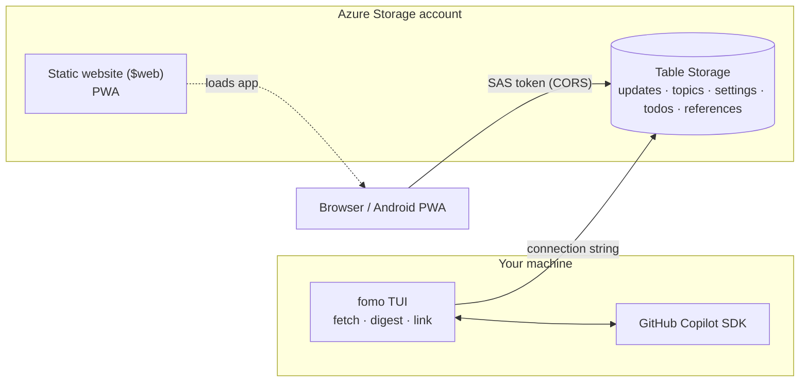

# 📰 FOMO

**Fear Of Missing Out** — a release & update tracker for developer tools.
Track GitHub releases, Azure updates, VS Code changelogs, Copilot CLI versions and tech news in one place,
with a **GitHub Copilot digest** that folds related updates into one topic with a few highlights.

One storage account · No servers · Two interfaces (terminal UI + installable web app)

---

## Table of Contents

- [Architecture](#architecture)
- [Copilot Digest](#copilot-digest)
  - [Post Summaries](#post-summaries)
  - [References](#references)
- [Installation](#installation)
  - [Azure Deployment](#azure-deployment)
  - [TUI Setup](#tui-setup)
  - [Connect the Web App](#connect-the-web-app)
  - [Install on Android](#install-on-android)
  - [Local Development](#local-development)
- [Using the Web App](#using-the-web-app)
- [Using the TUI](#using-the-tui)
  - [Keys](#keys)
  - [Config Screen](#config-screen)
  - [Backup & Restore](#backup--restore)
- [Sources](#sources)
- [Security](#security)
- [Environment Variables](#environment-variables)
- [Storage](#storage)
- [License](#license)

---

## Architecture



```
packages/
  core/     Shared types · Azure Table stores · scrapers · digest engine · services
  web/      React/Vite PWA — static files, talks to Table Storage directly
  tui/      Ink terminal UI (`fomo`) — setup, fetch, Copilot digest, device links, backups
```

- **No compute in Azure.** Everything lives in one Storage Account: Table Storage for data and the static website for the web app.
- **Fetch and digest run in the TUI** (`fomo`, then `f`) on your machine, using your GitHub Copilot subscription.
- **The web app is static.** It reads and writes Table Storage from the browser with a SAS token handed over by the TUI's **Link a device** action (magic link / QR code).
- **No command-line arguments.** `fomo` opens the TUI; everything else (setup, config, links, backups) is done from inside it.

---

## Copilot Digest

Instead of reading 200 separate updates, the **Unread** view (the default, key `2`) is grouped by topic: one line per product area,
usually 20–30 topics. Press `2` again to switch to a plain list of unread updates, and once more to go back to topics:

```
▸ ▲ Copilot CLI releases                          6   github, github-blog   2h ago
▸ Copilot code review                             9   github                5h ago
▸ Azure networking                                5   azure                 1d ago
▸ Azure retirements                               4   azure                 1d ago
```

Open a topic to see a one-sentence summary and up to six highlights (most important first). Each update in the topic also gets its own one-line summary, so you can decide which ones to open.
A topic with only one update doesn't expand: its row shows that update's title and summary directly, and `Enter` opens the update.
Mark the whole topic read with `x`, which makes skipping a low-value area a single key press.

The **Saved** view (key `4`) is grouped the same way (press `4` again for a plain list), so saved posts sit together by product area. Reading a saved post
keeps it there: `r` / `u` mark a topic or update read / unread (a blue `●` marks unread ones), `x` marks it read and
moves on, and `s` unsaves an update, which removes it from the view.

**Grouping.** Each topic is one **product or feature area**, such as "Copilot code review", "GitHub Actions", "VS Code releases", "Azure SRE Agent" or "Anthropic news":

- Topics usually hold 3–15 updates. A new topic with more than 15 gets a second call that splits it into narrower areas.
- There are no catch-all topics such as "Azure updates" or "Misc".
- Deprecations and retirements go into one topic per vendor ("Azure retirements"). Titles that mention a retirement or deprecation are flagged to the model.
- Releases of one product stay together. Items whose titles differ only in version numbers are flagged to the model as a release series.
- General essays go into one topic per source ("GitHub blog essays").
- New products and major launches get their own topic so they aren't buried.

**Importance.** Each topic is rated so you can tell what's worth reading:

| Level  | Shown as                        | Typical updates |
|--------|---------------------------------|-----------------|
| High   | `▲` (orange) · sorted first     | New products, major versions or revamps, big features in widely used tools, flagship models |
| Medium | normal                          | Notable features, previews reaching GA, releases with real changes, breaking changes that hit common setups soon |
| Low    | dimmed · sorted last            | Patches, regions, admin settings, SKUs, distant deprecations, research, partnerships, surveys, marketing |

Deprecations and protocol changes (such as an SSH algorithm) are never rated high. The digest is sorted by importance, then newest first.

To steer the rating toward what you care about, add an optional interests note (`c` → **Interests**), for example
`Copilot CLI and agents, VS Code; not SAP or billing`. It moves a topic up or down by at most one level and never changes the grouping.
Save an empty value to clear it.

To steer the **grouping** itself, add **Grouping hints** (`c` → **Grouping hints**, or `FOMO_GROUPING_HINTS`), for example
`one topic per Copilot surface (CLI, VS Code, code review); keep all Azure AI Foundry news together`.
Hints take priority over the built-in grouping rules, but every update still lands in exactly one topic. They apply to new runs; use **Regroup all topics** to apply them to existing topics.

How it works:

- `f` in the TUI fetches the sources and then runs the digest in the background; new updates show up ungrouped right away and the status bar shows Copilot's progress. Turn **Group after fetch** off in the config screen to fetch only.
- Only **unread or saved updates that don't have a topic yet** are sent to Copilot (saved ones even after you've read them, so the Saved view is grouped too), in two passes:
  1. **Plan:** one call sees every pending update (title and a short excerpt, or its [post summary](#post-summaries) when it has one) plus the currently open topics. It assigns each update to an existing or new topic and rates it. Updates the model skips get one more call; oversized new topics get a split call.
  2. **Write:** one small call per touched topic writes the summary, the highlights and a one-sentence summary of each new update. These run 6 at a time with low reasoning effort, and a failed call is retried once.
- Topics are stored in the `topics` table, and each update points to its topic (`topicId`), so the web app and TUI only read.
- Updates that haven't been digested yet still appear in the grouped Unread and Saved views as single-item entries.
- About 220 updates take roughly 2 minutes. **Max items per run** (default 300) caps a run; the rest are grouped next time.
- The default model is `gpt-5-mini`. Change it with **Copilot model** in the config screen or `FOMO_COPILOT_MODEL`.
- Existing topics keep their grouping and rating. **Regroup all topics** in the config screen (or `z` twice in the TUI's main view) regroups and re-rates all unread and saved updates (read and saved status is untouched). This also fills in per-update summaries for updates digested before they existed.
- If regrouping fails before processing any updates, FOMO restores the previous topic assignments and shows the first error.
- Authentication: pick a GitHub account with **Copilot account** in the config screen. It lists the accounts signed in to the GitHub CLI (`gh auth login`), and FOMO asks `gh` for that account's token. On **Automatic** (the default), it uses `COPILOT_GITHUB_TOKEN` / `GH_TOKEN` / `GITHUB_TOKEN`, else your logged-in Copilot CLI user or gh's active account. If Copilot answers `Authorization error`, the message names the rejected account; choose one with Copilot access.

### Post Summaries

Press `g` on an update in the TUI to have Copilot summarise it: one sentence with the gist, then 3–5 short points (what it does, who it's for, how to get or enable it, limits or deadlines).

- FOMO fetches the linked page and summarises whichever is longer: the page text or the stored preview. The page is only used if it mentions the post's title, so sign-in walls and pages that only render with JavaScript fall back to the preview.
- Azure Updates pages render with JavaScript and the feed cuts their descriptions to about 250 characters, so their full text comes from the Azure release communications API instead (with status and preview / GA dates).
- Posts with less than 1,000 characters of text aren't summarised, because a summary wouldn't be any shorter.
- The summary is saved on the update, so pressing `g` again shows it without calling Copilot. Press `g` once more while it's shown to regenerate it.
- Summaries appear at the top of the detail pane in the TUI and the web app, and search matches them too. The web app only shows saved summaries; it can't create them.
- When Copilot groups a post or writes its topic, it reads the post's summary instead of the start of the feed preview. Summarise posts before they're grouped (or before **Regroup all topics**) to have it take effect.

### References

**References** is a bookmark library. It keeps links you want to come back to, filed in a folder tree like `ai/agents` or `azure/iac` (up to 6 levels deep). **Saved** is still for reading later; References is for links worth keeping.

- **File a feed update:** press `m` on an update in the TUI or the web app, or use the 🔖 button in the detail pane. The title, URL and any summary are filled in.
  - In the TUI, Copilot also suggests a folder (reusing your existing folders where they fit) and a one-line description. Edit either before saving.
  - If the link is already filed, `m` opens it for editing instead of adding a duplicate.
- **Add any link:** open References (`5`) and press `a`. The new link goes in the selected folder.
  - In the TUI form, `^G` asks Copilot to suggest a folder and description, and a title if one is missing. FOMO fetches the page to do this.
- **Folders** exist only as long as they hold links; they're not stored separately. Type a new path to create one.
  - `e` on a folder renames or moves it together with its subfolders. `e` on a link edits it.
  - `d` twice deletes a link.
- **Search** (`/`) matches titles, URLs, folders and descriptions.
- Copilot suggestions run only in the TUI. In the web app, you type the folder and description yourself, picking from existing folders.

---

## Installation

### Azure Deployment

**Prerequisites:** Azure CLI (`az login`), `jq`, Node.js 22+ and pnpm.

```bash
pnpm install
bash deploy.sh fomo swedencentral        # add -y to skip the what-if prompt
```

The script:

1. Builds the web app.
2. Deploys `infra/main.bicep`: one Storage Account with the `updates`, `topics`, `settings`, `todos` and `references` tables, plus Table Storage CORS for the static website origin (and `localhost:5173`/`4173` for dev).
3. Enables the static website and uploads the PWA to `$web`.
4. Prints the web app URL and the next steps.

### TUI Setup

```bash
pnpm --filter @fomo/tui... build
node packages/tui/dist/index.js      # or put `fomo` on your PATH: (cd packages/tui && npm link)
```

The first time, `fomo` asks for the storage connection string. Get it with:

```bash
az storage account show-connection-string -g fomo -n <account> -o tsv
```

Paste it and press `Enter`; FOMO checks the connection and saves it to `~/.fomo/config.json`.
Then press `c` and set **Web app URL** (printed by `deploy.sh`, e.g. `https://<account>.z1.web.core.windows.net/`).

The digest needs GitHub Copilot. If you use the Copilot CLI, you're already signed in; otherwise export `COPILOT_GITHUB_TOKEN`.
If `gh` has several GitHub accounts, press `c` and pick the one with Copilot under **Copilot account**.
Press `f` to fetch all sources and build the digest.

### Connect the Web App

In the TUI press `c` → **Link a device**. It shows a magic link and a QR code; `o` opens the link, `y` copies it.
Links are valid for 365 days; change **Link valid (days)** in the config screen for shorter-lived links.

Open the link (or scan the QR code with your phone). It carries a Table Storage SAS token in the URL
fragment (`#…`), which is never sent to any server. The web app saves it in the browser and removes it from the address bar.
You can also paste the link into the app's connect screen.

The status bar warns you when the token has 14 days or less left. Create a new link to renew it. **Disconnect** removes the token from that browser.

### Install on Android

1. Open the magic link in **Chrome** on your phone. Scanning the QR code from **Link a device** works well.
2. Tap **⋮ → Add to Home screen → Install**.

FOMO then runs full-screen from your home screen like a native app. The app shell works offline, and data loads from Table Storage when you're online. Pull down on the list to refresh.
On iOS, use Safari → Share → **Add to Home Screen**.

### Local Development

```bash
pnpm install
pnpm build
pnpm test

# Local storage emulator (optional)
npx azurite --silent --location /tmp/azurite &
az storage cors add --services t --origins http://localhost:5173 http://localhost:4173 \
  --methods GET HEAD POST PUT PATCH MERGE DELETE OPTIONS --allowed-headers '*' --exposed-headers '*' \
  --connection-string "UseDevelopmentStorage=true"

# Web app dev server
pnpm --filter @fomo/web dev

# TUI against Azurite: paste UseDevelopmentStorage=true at setup (or set it under c → Connection string),
# set Web app URL to http://localhost:5173/, press f, then c → Link a device to connect the dev server.
fomo
```

With Azurite, **Link a device** creates a SAS token that also allows `http`. The `az storage cors add` command lets the browser call Azurite from the dev server; it mirrors the CORS rule that Bicep sets in Azure.

---

## Using the Web App

The web app mirrors the TUI: the same dark text UI and the same keys. On a phone, tap rows, use the action bar, and pull to refresh.

| Key             | Action                                    |
|-----------------|-------------------------------------------|
| `1` `2` `3` `4` | All / Unread / Read / Saved               |
| `2` / `4` again | Switch Unread / Saved between topics and a list (or click the active tab) |
| `5`             | [References](#references) (`5` again returns to the previous view) |
| `6`             | Todos                                     |
| `m`             | File the selected update in References    |
| `/`             | Search titles & content in the current view (`Enter` searches, `Esc` clears) |
| `v`             | Pick which sources to show (`space` toggle, `a` all, `n` none, `Enter` apply); `Esc` clears it after the search |
| `j` / `↓`       | Next row                                  |
| `k` / `↑`       | Previous row                              |
| `Shift`+`↑` / `↓` | Jump 5 rows (10 on a tall window)       |
| `Enter`         | Topics: expand topic · Lists: toggle detail |
| `→` / `l`, `←`  | Topics: expand / collapse topic           |
| `x`             | Mark read (the whole topic when grouped) & next |
| `r` / `u`       | Mark read / unread (a whole topic in grouped Saved) |
| `n`             | Next topic / next unread                  |
| `s`             | Save / unsave (unsave in the Saved view)  |
| `o`             | Open URL in a new tab                     |
| `.`             | Toggle preview position (right / bottom)  |
| `c`             | Config                                    |
| `h`             | Help (also shows the version)             |

Letter keys work in either case: `M` does the same as `m`.

Fetching isn't done in the browser. Run `fomo` on your computer and press `f`, then pull to refresh.
Post summaries made in the TUI (`g`) show at the top of the detail pane.

**Search** only looks inside the view you're in: searching under Unread only finds unread updates (or unread topics when grouped), and under Saved only saved updates. Every word must appear in the title, summary, [post summary](#post-summaries) or content (case-insensitive). The query stays applied when you switch views until you clear it with `Esc` or ✕. On a phone, tap the search box in the filter bar.

---

## Using the TUI

Run `fomo`. It opens on **Unread**, grouped by topic. There are no subcommands: `fomo --help` and `fomo --version` are the only flags.

### Keys

| Key             | Action                                    |
|-----------------|-------------------------------------------|
| `1`–`4`         | All / Unread / Read / Saved               |
| `2` / `4` again | Switch Unread / Saved between topics and a list |
| `j`/`↓`, `k`/`↑`| Move                                      |
| `Shift`+`↑` / `↓` | Jump 5 rows (10 on a terminal 40+ lines tall) |
| `Enter`         | Expand topic and open it / toggle detail  |
| `→`/`l`, `←`    | Expand / collapse topic                   |
| `x` / `r`       | Mark topic (or update) read & next (grouped Saved: `r` marks read in place) |
| `u`             | Mark unread (lists, and topics or updates in grouped Saved) |
| `n`             | Next topic / next unread                  |
| `s`             | Save / unsave (unsave in Saved)           |
| `o`             | Open in browser (newest update of a topic)|
| `p`             | Fetch full content (detail view)          |
| `g`             | [Summarise the update with Copilot](#post-summaries) (saved); `g` again while it's shown regenerates it |
| `f`             | Fetch latest updates + Copilot digest     |
| `z` twice       | Regroup all topics with Copilot (`Esc` after the first `z` cancels) |
| `c`             | Config: sources, link a device, backup / restore, local settings |
| `5`             | [References](#references): links filed into folders (`5` again closes) |
| `6`             | Todos (`a` add, `Enter` cycle status, `d` delete, `6` again closes) |
| `m`             | File the selected update in References (Copilot suggests a folder and note) |
| `/`             | Search titles & content in the current view (`Enter` searches, `^U` clears the prompt) |
| `v`             | Pick which sources to show (`space` toggle, `a` all, `n` none, `Enter` apply) |
| `Esc`           | Clear the search, then the source filter  |
| `.`             | Show preview / toggle its position        |
| `a`             | [Audit trail](#audit-trail) of actions and errors (`e` errors only, `Esc` closes) |
| `h`             | Help (also shows the version)             |
| `q`             | Quit                                      |

Letter keys work in either case: `M` does the same as `m`, so `Shift`+`j`/`k` still moves one row. macOS Terminal.app has no default mapping for `Shift`+`↑`/`↓`: add one under Settings → Profiles → Keyboard that sends `\033[1;2A` / `\033[1;2B` (press `Esc` to type `\033`).

The status bar shows counts by status; the config screen shows counts per source.
Search (`/`) works like the web app: it's scoped to the current view, matches every word against the title, summary and content, and shows the query and match count in the filter bar until `Esc` clears it.
The source filter (`v`) lists the sources in the current view with their counts (honouring the search), stays applied across views like the search, and shows as a `src:` chip next to it.
While a fetch, Copilot digest or restore runs, the status bar shows a spinner, the current step and the elapsed time.
While the TUI is open, it automatically fetches every 15 minutes by default, starting one interval after launch. Each run fetches all enabled sources and groups updates with Copilot when auto-digest is enabled, just like `f`. A scheduled run is skipped if a fetch, regroup or restore is already running; closing the TUI stops the timer. The status bar shows when the last fetch finished and when the next automatic one is due (`fetched 19:30 · next 19:45`). Set **Auto-fetch (minutes)** in the config screen to any whole number from 5 to 1440, or to `off` to fetch only with `f`; saving it empty restores 15.
Fetch errors and Copilot runtime logs are written to `~/.fomo/fomo.log` instead of the screen.

#### Audit trail

Every action and every error is recorded in `~/.fomo/audit.log`, one JSON object per line (`ts`, `level`: `info` or `error`, `action`, `detail`). This covers:

- **Runs:** manual and automatic fetches (including skipped runs and each failed source), Copilot digests and regroups (each failed Copilot call), summaries, backups and restores.
- **Reading:** read / unread / save changes (with the update title), opening links, views, searches and source filters.
- **Settings, todos and references:** todos, references, source and config changes, linking a device and setup.
- **Errors:** storage errors, `console.error` output and crashes.

Press `a` to browse it, newest first. Use `↑`/`↓` to move (the full message of the selected entry shows below the list), `e` to show errors only and `Esc` to close. The view updates while it's open.

Connection-string keys and SAS signatures are masked, and the device link itself is never recorded. When the file reaches 1 MB it moves to `audit.log.1`, so at most about 2 MB is kept.

### Config Screen

Press `c`. The bottom line shows the keys for the selected row. Each section header folds: `Enter`/`←` collapses it, `Enter`/`→` expands it, and `←` on any row folds its section. The list scrolls with the focus; `Shift+↑/↓` jumps 5 rows (10 on a tall screen) and `PgUp`/`PgDn` move a page. `/` filters the rows (all words must match; a matching section name keeps its whole section), `Enter` keeps the filter and `Esc` clears it. The help overlay (`h`) has the same `/` search.

| Section | Row | Keys |
|---------|-----|------|
| **Actions** | Link a device | `Enter`: magic link + QR code for the web app (`o` open, `y` copy) |
| | Show web app QR | `Enter`: QR code of the plain web app URL (no access token) to open it on your phone · `o` opens it in the browser |
| | Regroup all topics | `Enter` twice: rerun the Copilot digest on every unread and saved update |
| | Back up updates / Restore from backup | See [Backup & Restore](#backup--restore) |
| **Sources** (shared with the web app) | One row per source, with its item count, when its newest item was added, and when it was last fetched (or the error of that fetch) | `Enter` details (status, label, color, on/off; name, URLs and filter for your own sources; `s` saves) · `Space` enable/disable · `e` label · `d` color · `f` fetch just this source (even if disabled) · `v` list only its updates · `x` remove (`x` again keeps its items, `d` deletes them too). A removed source whose items are kept stays greyed out until you delete them (`x` twice, or `d` twice in its details); in a source's details `d` twice deletes its items, so the next fetch brings them back as new. **+ Add source** adds a feed, GitHub repo or YouTube channel; **Restore removed** brings back removed built-ins |
| **Display** (shared) | Preview position | `Enter` cycles right / bottom / off |
| **This computer** (`~/.fomo/config.json`) | Connection string, Web app URL, Copilot model, Copilot account, Interests, Grouping hints, Auto-fetch (minutes), Group after fetch, Max items per run, Link valid (days), Backup folder | `Enter` edits (Auto-fetch takes 5–1440 minutes or `off`; Group after fetch toggles; Copilot account opens a list of your `gh` accounts). Save an empty value to restore the default. Values set by an environment variable are tagged `[env]`. `o` on Web app URL opens it in the browser. |

### Backup & Restore

**Back up updates** writes every update from Table Storage to `fomo-backup-<timestamp>.json` in the backup folder
(default `~/.fomo/backups`, change it under **Backup folder**).

**Restore from backup** lists the `.json` files in the backup folder, newest first. Pick one and press `Enter` twice.
Entities are upserted, so this is safe for both fresh and incremental restores; nothing is deleted.

The backup format is `{ version: 1, exportedAt, count, entities: [...] }`.

---

## Sources

### Built-in Sources

| Source | ID | What it tracks |
|--------|----|----------------|
| GitHub | `github` | GitHub Releases (Node.js, TypeScript, etc.) |
| GitHub Blog | `github-blog` | GitHub Blog posts |
| Azure | `azure` | Azure Updates RSS feed |
| VS Code | `vscode` | VS Code releases (official Atom feed) |
| Copilot CLI | `copilot-cli` | GitHub Copilot CLI releases |
| The Register | `theregister` | The Register tech news (Atom feed) |
| Anthropic News | `anthropic-news` | Anthropic news |
| Anthropic Engineering | `anthropic-engineering` | Anthropic engineering blog |
| Azure SRE Agent | `azure-sre-agent` | Azure Updates announcements and Apps on Azure Tech Community posts mentioning SRE Agent |
| GitHub Next | `github-next` | GitHub Next research & prototypes (RSS) |

The Azure SRE Agent source combines Microsoft's public Azure Updates RSS feed
with the latest 100 posts from Tech Community's Apps on Azure blog, filtering
titles and descriptions for SRE Agent mentions. This includes blog guides and
feature posts as well as release announcements, without the legacy Azure Charts
endpoint's authentication requirement. These are rolling feeds (Azure Updates
currently returns 200 announcements), not complete archives or date-based resume
APIs. Each fetch adds previously unseen URLs; stored updates are retained.

### Adding a New Source

Most sources need no code:

- **From the app:** in the TUI press `c` → **+ Add source** and type an RSS/Atom feed URL (several: separate with
  spaces), `https://github.com/owner/repo` or a YouTube channel/playlist URL, a name, and an optional keyword filter (regex). In the web app use
  the form under ⚙️ Config → **Sources**. Sources you add are stored in the shared settings; `x` (TUI) or ✕ (web)
  removes a source, and removed built-ins can be restored. Open a source (`↵` in the TUI, click its name in the
  web app) to see its status and edit it.
- **Built-in:** add a `feed`, `github-releases` or `youtube` spec to `BUILTIN_SOURCES` in
  `packages/core/src/scraper/specs.ts`.
- **Custom code** (sites without a feed): add a module in `packages/core/src/scraper/sources/custom/`, register it in
  its `index.ts`, and point a `custom` spec at it.

See [EXTENDING.md](EXTENDING.md) for the spec fields and the shared helpers for custom sources.

---

## Security

- **TUI:** uses the storage connection string (account key). Keep `~/.fomo/config.json` private (it is created with mode `600`).
- **Web app:** uses an **account SAS token** limited to the Table service and entity operations (`ss=t`, `srt=o`, `sp=raud`), HTTPS only, and valid for **Link valid (days)** (default 365).
  - It can read and update your FOMO tables, but it cannot create or delete tables or touch blobs.
  - It is delivered in the URL fragment, so it never reaches a web server or logs, and it is stored in the browser's `localStorage`.
- **Revoke every link:** rotate the storage key that signed it (**Link a device** signs with the key in your connection string, usually `key1`):
  ```bash
  az storage account keys renew -g fomo -n <account> --key key1
  ```
  Then set the new connection string in the TUI (`c` → **Connection string**) and link your devices again.
- **CORS:** Table Storage only accepts browser calls from the static website origin (and localhost dev ports). Add custom domains with the `extraCorsOrigins` Bicep parameter.
- The static website itself is public, but it contains no data.

---

## Environment Variables

All are optional. The TUI config screen (`c` → **This computer**) stores the same values in `~/.fomo/config.json`.

| Variable                          | Description                                                  |
|-----------------------------------|--------------------------------------------------------------|
| `AZURE_STORAGE_CONNECTION_STRING` | Connection string (fallback when the config file has none)   |
| `FOMO_WEB_URL`                    | Web app URL for **Link a device** (overrides config)         |
| `FOMO_COPILOT_MODEL`              | Copilot model for the digest (overrides config)              |
| `FOMO_INTERESTS`                  | Interests note for digest importance (overrides config)      |
| `FOMO_GROUPING_HINTS`             | Grouping hints for the digest (overrides config)             |
| `COPILOT_GITHUB_TOKEN` / `GH_TOKEN` / `GITHUB_TOKEN` | Token for the Copilot SDK when **Copilot account** is Automatic (default: logged-in Copilot CLI user or gh's active account) |

---

---

## Storage

| Table      | PartitionKey                       | RowKey                       | Contents                              |
|------------|------------------------------------|------------------------------|---------------------------------------|
| `updates`  | Source ID (e.g. `azure`, `github`) | `sha256(url).slice(0, 32)`   | Updates, status, saved, `topicId`, Copilot `summary` and `gist` (post summary, JSON) |
| `topics`   | `topic`                            | Topic id                     | Copilot title, summary, highlights    |
| `settings` | —                                  | —                            | Shared UI/source settings             |
| `todos`    | —                                  | —                            | Personal todos                        |
| `references` | `ref`                            | UUID                         | Bookmarked links: title, URL, folder path (`ai/agents`), description, source `updateId` |

Status updates use ETag-based optimistic concurrency.

---

## License

MIT
